I pointed AI at [Moser's worm](https://en.wikipedia.org/wiki/Moser%27s_worm_problem),
a classic geometry problem that has been unsolved for 60 years.
Within a month, AI improved the best lower and upper bounds in the peer-reviewed literature, shrinking the
gap between them by over 75%. It also formally verified the full proofs in [Lean](https://lean-lang.org/).

This post walks through the project, from a failed first attempt to the final result.
For full technical details: [paper](https://arxiv.org/abs/2609.21968) and [code](https://github.com/ethan-keller/moser-worm-improved-bounds).

## Progress in math

Not long ago, language models were bad at math. In early 2023, GPT-3.5 would confidently get simple arithmetic wrong:

<figure class="narrow">
  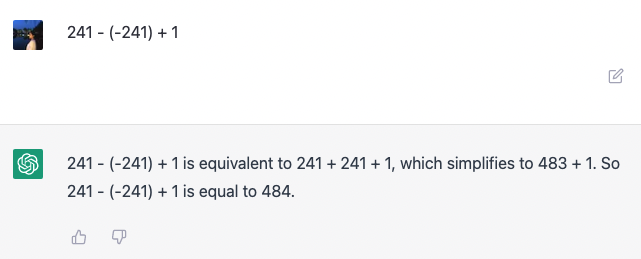
  <figcaption>An example of an arithmetic mistake with GPT-3.5 (post by 'daisyyedda' on the
  <a href="https://community.openai.com/t/chatgpt-simple-math-calculation-mistake/62780">OpenAI
  community forum</a>).</figcaption>
</figure>

That didn't last. Within a year, the models were solving most
high-school math problems, and by 2024 Google DeepMind's AlphaProof and AlphaGeometry 2 had reached
[silver-medal level](https://deepmind.google/discover/blog/ai-solves-imo-problems-at-silver-medal-level/)
at the International Mathematical Olympiad (IMO). A year later,
[Gemini Deep Think](https://deepmind.google/discover/blog/advanced-version-of-gemini-with-deep-think-officially-achieves-gold-medal-standard-at-the-international-mathematical-olympiad/)
and an [experimental OpenAI model](https://x.com/alexwei_/status/1946477742855532918/)
both achieved gold-medal level.

In 2026, the focus increasingly shifted from benchmarks and competitions to open research problems.
Anthropic's Claude helped find a [counterexample to the Jacobian conjecture](https://x.com/__alpoge__/status/2079028340955197566),
and improved a long-standing bound on [the zeros of the Riemann zeta function](https://www.anthropic.com/research/riemann-zeta). OpenAI even announced progress on [Navier-Stokes](https://openai.com/index/navier-stokes-solution/),
one of the Millennium Prize Problems, along with [a few hundred more results](https://github.com/openai/math).

## Why Moser's worm?

One of the first big AI results in math that caught my eye was the [disproof of Erdős's unit distance conjecture](https://openai.com/index/model-disproves-discrete-geometry-conjecture/),
a problem in discrete geometry. I remember wondering whether I knew any discrete geometry problems I could attempt
with AI. One came to mind.

Back in high school, some friends and I took part in a math competition called *Wiskunde B-dag*, held in Belgium,
the Netherlands, Germany and Slovakia. The Belgian version is co-organized by
[KU Leuven](https://wis.kuleuven.be/nederlands/scholieren/wiskunde-b-dag-vlaanderen) and the
[University of Antwerp](https://www.uantwerpen.be/nl/evenementen/wiskunde-b-dag/wat-is-de-wiskunde-b/).
Teams of three or four students spend a full day working on an open-ended math problem and write up their findings in a report.
The reports are judged in two rounds, with a final committee picking the winners.

In the 2018-2019 edition, the problem was based on [Moser's worm](https://en.wikipedia.org/wiki/Moser%27s_worm_problem),
a classic open problem in discrete geometry. We finished third!

<figure class="narrow">
  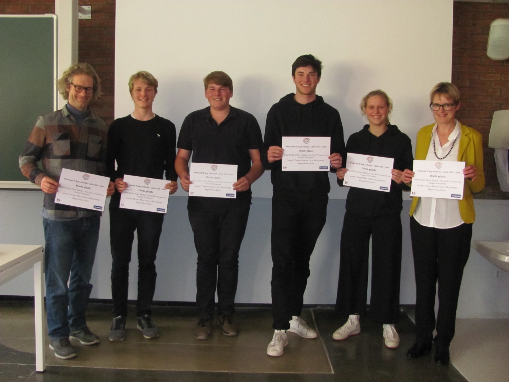
  <figcaption>Award ceremony of Wiskunde B-dag 2018-2019. From left to right: Thomas Maas, Arnaud Verstraeten, Pieter Markey, me, Ann-Sophie Vergauwe, Lieve Bleyenbergh.</figcaption>
</figure>

## Leo Moser's worm

In 1966, the Austrian-Canadian mathematician Leo Moser asked for the smallest area of a shape that can cover
every curve of length 1.[^moser] The question became known as Moser's worm problem.

A *worm* is a curve of length 1 in the plane. It can be straight, circular, L-shaped, S-shaped,
V-shaped, zigzag, spiral, anything. The worm is infinitely thin.

<figure>
  
  <figcaption>Examples of different worms. Every one of these has length exactly 1.</figcaption>
</figure>

A *cover* is a shape that contains a congruent copy of every worm. In other words, you can move, rotate or reflect
each worm so that it 'fits'. Think of it as a blanket that has to fit the worm however it curls up.

<figure>
  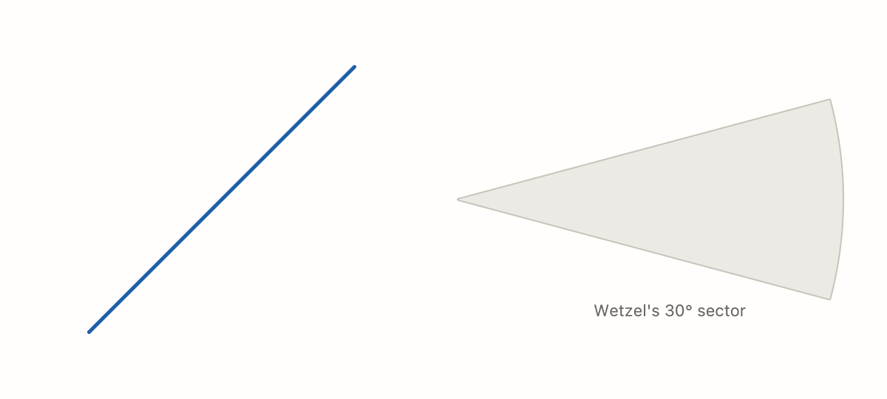
  <figcaption>Wetzel's 30° sector, a known convex cover, fitting six example worms.</figcaption>
</figure>

Here, covers are restricted to *convex* shapes, meaning shapes without dents. A straight line between any two
points in the shape stays inside it. This is how the problem is usually stated and studied. It's also the version
where the optimum is guaranteed to exist. Formally, the goal is to find

$$\alpha = \inf \{\operatorname{area}(K) : K \subseteq \mathbb{R}^2 \text{ is a convex cover}\}.$$

Nobody has been able to find the optimum $\alpha$, so instead the literature has pinned it between two bounds,

$$\mathrm{LB} \le \alpha \le \mathrm{UB}.$$

The *lower bound* (LB) is a value that, provably, no cover can go below. The *upper bound* (UB) is the area
of a proven convex cover, so the optimum can't be any larger.

For decades, mathematicians have been pushing these two numbers closer together.

<figure>
  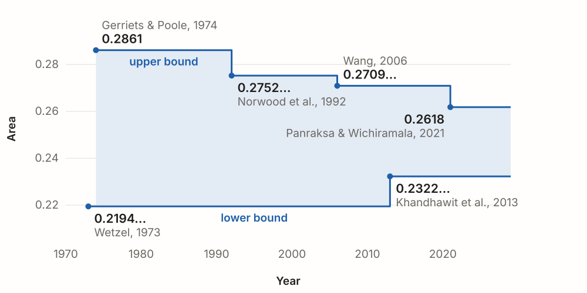
  <figcaption>The peer-reviewed bounds over the last five decades.</figcaption>
</figure>

The best peer-reviewed bounds are $0.232239$, by Khandhawit et al.,[^kps] and
$\pi/12 \approx 0.2618$, the area of a 30° sector cover conjectured by
Wetzel in the seventies and only proven in 2021.[^pw] That leaves a gap of
roughly $0.03$.

Making progress means raising the lower bound or lowering the upper bound. When they meet,
the problem is solved.

## Setup

I used off-the-shelf agentic coding tools throughout the project: [Codex](https://openai.com/codex/),
first with GPT-5.6 Sol and later GPT-6 Astra, and [Claude Code](https://claude.com/product/claude-code/) with Claude Fable 5.
The agents could run code, read and write files, search the web and spawn subagents.
I deliberately kept the setup minimal with no MCP servers, skills, plugins or custom orchestration.

My role was mostly to start sessions, give each one a single instruction file like `AGENTS.md`,
monitor the system and occasionally step in with a short prompt.

## First attempt

As a first lazy attempt, I decided to start simple:
one [Codex](https://openai.com/codex/) session with GPT-5.6 Sol on max effort, one [`AGENTS.md`](/assets/posts/ai-tackles-a-60-year-old-math-problem/first-attempt-AGENTS.md.txt)
describing the task, and a short prompt:

> Start. Fan out to as many subagents as needed.
{: .me data-who="Me"}

Once the session had taken off, I mostly monitored. A clear division of work was emerging.
Some agents reviewed the literature, some set up structured reporting, some explored new approaches and others tried to improve existing ones. I'd be lying if I said I wasn't slightly hoping for a full solution within a few hours.

Instead, I ran into three main problems:

1. **I couldn't supervise.** My lack of domain knowledge made it hard to spot mistakes, recognize opportunities
or push the agents in certain directions. They wrote pages of confident, specialized mathematics full of
terms like 'hull-word stratification' and 'K7 packet geometry', and I genuinely couldn't tell
real jargon from made-up words. So I had to trust the agents' judgment.

2. **The agents kept forgetting.** At the time of this experiment, Codex limited GPT-5.6 Sol to a 272k-token context window, even though the model supports 1M
([now configurable](https://x.com/thsottiaux/status/2089082893804896524)).
For this kind of reasoning task, that didn't work well. Context filled up quickly, and after a few rounds of auto-compaction,
agents were cut off mid-task, treated unfinished work as complete, and re-explored directions that had already been
closed. Findings were also poorly organized. The agents built flat folders of over 1,000 long reports
without reliable indexing or summaries.

3. **The agents gave up early.** Literature reviews were brief or skipped. Many tracks were stopped after a single negative
result, and topics labeled hard were avoided. This limited the exploration, which is crucial in research. Some breakthroughs have come from bridging ideas that seemed totally unrelated at first, like the [Erdős disproof](https://openai.com/index/model-disproves-discrete-geometry-conjecture/).

I tried mitigating the third problem with simple encouragement prompts.
The labs reported this trick of sending messages like
['keep going' and 'believe in yourself'](https://www.anthropic.com/research/riemann-zeta) to push an agent past
its own skepticism. It's hard to evaluate whether that worked.

I also nudged the main agent to explore neighboring areas of math and even physics.
My reasoning was that a problem open for 60 years would need some kind of unexpected leap from another domain.
In hindsight, that might have been too strong an assumption, and it likely wasted some of the agents' capacity.

In total, the session explored 149 directions over almost three days.

<figure>
  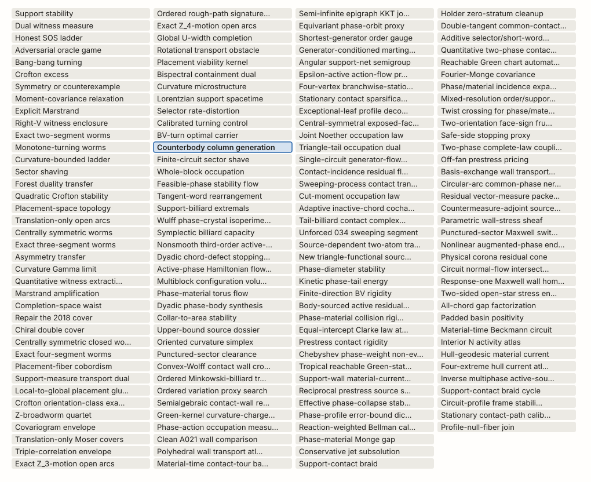
  <figcaption>All 149 attempts. Only the highlighted attempt was reported as positive.</figcaption>
</figure>

Surprisingly, one attempt *'counterbody column generation'* came back positive. An agent reported that it had raised the lower bound from $0.232239$ to $0.23233$, an improvement of $9.1 \times 10^{-5}$. I asked a few referee agents to verify it. Unfortunately, the verdict came back as a false positive...

What stood out was that many agents spent most of their time on big computational jobs, like numerical searches
over millions of worm arrangements. That made sense given the combinatorial nature of the problem.
However, the jobs were poorly optimized leaving the agents mostly waiting.

## A new lower bound

For the second attempt, I decided to focus on the lower bound.
The previous best lower bound by Khandhawit et al.[^kps] builds on
work by Khandhawit and Sriswasdi[^ks] that used a grid search, an approach that suits
my computer science background.

For a cover to hold any worm, it must also hold any *worm family*, a finite set of worms.
The area a worm family needs in its tightest arrangement is therefore a lower bound for the optimal cover.
Finding a new lower bound comes down to finding a worm family whose tightest arrangement needs more area than the
previous best lower bound.

<figure>
  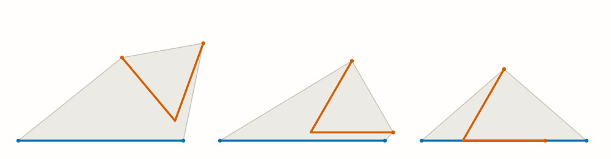
  <figcaption>A two-worm family in three arrangements. The right-most one requires the least area.</figcaption>
</figure>

The hard part is finding the tightest arrangement of a worm family, since there
are infinitely many to choose from. Each worm has an angle, two position
coordinates $(x, y)$, and can also be mirrored. One worm can be held fixed, so
$n$ worms leave $d = 3(n-1)$ continuous parameters and $n-1$ binary mirror choices.

Branch and bound[^bnb] is a method from global optimization that can turn this infinite search into a finite proof.
First, you pick a target area which represents the bound you hope to prove.
Then, you divide the $d$-dimensional space of arrangements into boxes, each covering a range of angles and positions.
For each box, you compute a lower bound on the area of every arrangement inside it.
If that bound meets the target, the box is ruled out. Otherwise, the box is split and checked again.

<figure class="narrow">
  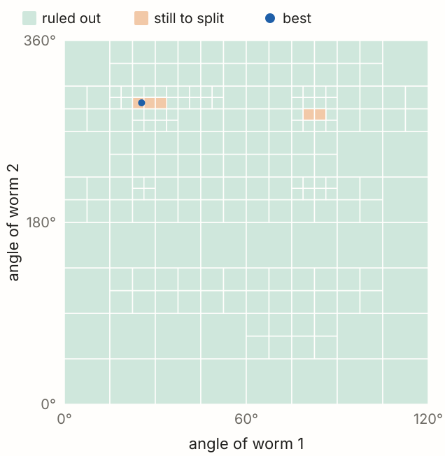
  <figcaption>Branch and bound on a toy problem. Green boxes are ruled out and orange boxes still need splitting.</figcaption>
</figure>

In practice, the bottleneck is the exponential cost.
In the worst case, every parameter is halved $m$ times, resulting in $2^{m \cdot d} = 2^{m \cdot 3(n-1)}$ boxes.
For a family of four worms, halving each parameter just five times already means about 35 trillion boxes.
However, branch and bound usually does better than this brute-force cost, since a box that's ruled out early is never split again.

In my first attempt, the agents had already spent much of their time on computational searches.
So I opened a Claude Code session with Claude Fable 5 on max effort, which had the full 1M-token context,
and gave it the work from my first attempt:

> Read *[redacted computational experiments path]* and use those techniques to find a lower bound breakthrough.
> You're completely free to optimize, find ways to reduce search
> space, improve efficiency.
{: .me data-who="Me"}

The agents came up with clever pruning rules to exploit symmetries and
limit how far apart the worms can be.
They also wrote optimized, parallelized C code, which sped up the search by around 1,000x compared to the slow
searches from my first attempt.

About ten hours after the start of the session, the main agent reported a new lower bound of $0.2365$,
beating the previous best in the literature.
I was stunned, but also very skeptical.

In the meantime, the agents kept improving their search and delivered a burst of new lower bounds, each beating the last.
The best lower bound result came another five days later:

> **Both signs CERTIFIED ≥ 0.2390** — and this time the artifacts wrote cleanly.
{: .agent data-who="Claude Fable 5"}

<figure>
  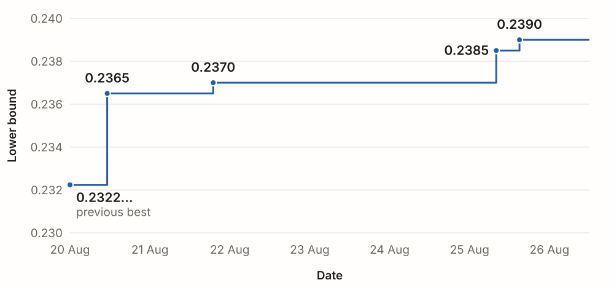
  <figcaption>The lower bound rose from $0.232239$ to $0.239$ in five days.</figcaption>
</figure>

The best worm family had four polygonal worms, whose symmetries cut down the search a lot.
For example, one of the worms spans an equilateral triangle. Rotate that triangle by 120° and you get exactly the
same triangle back, so only a third of the worm's angles need to be checked.
A half-turn of the whole arrangement doesn't change its area either, which further reduces the angle range to just a sixth.

<figure>
  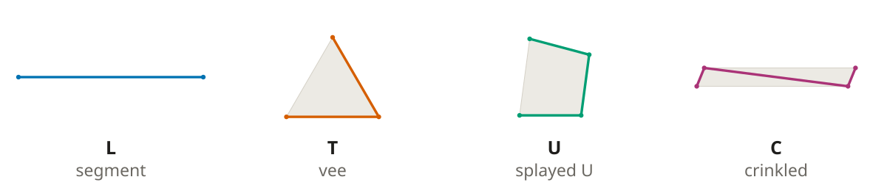
  <figcaption>The four worms of the best worm family.</figcaption>
</figure>

The agents found a tight arrangement for this worm family with an area of about $0.23944$, so they set the
branch-and-bound target just below that, at $0.239$. Aiming closer would have slowed down the search.

<figure>
  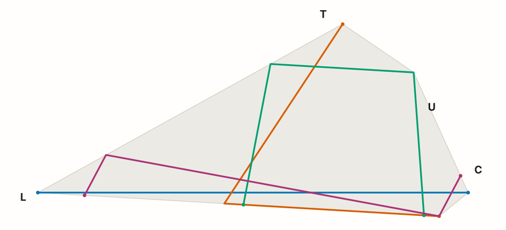
  <figcaption>The tightest arrangement found with an area of about $0.23944$.</figcaption>
</figure>

The agents also found larger families of five or more worms whose best found
arrangements needed an area of around $0.243$. However, proving bounds
with them would have required more compute or different methods.

A better lower bound is likely within reach, and the
[code](https://github.com/ethan-keller/moser-worm-improved-bounds) is public for
anyone curious to try.

## A new upper bound

While I was checking the lower bound results, OpenAI released GPT-6 Astra.
Without expecting much, I wrote a new [`AGENTS.md`](/assets/posts/ai-tackles-a-60-year-old-math-problem/upper-bound-AGENTS.md.txt) addressing
some problems from my first attempt and launched a new Codex session with Astra on max effort.

This time I biased the session toward analytical methods, which I thought might lead to more elegant arguments.

After 22 hours, the agents had found a cover of area $0.2559$, a new upper bound beating the previous one of about $0.2618$.
While investigating the result, I let the session continue. The agents were working on a subproblem for quadrilateral covers,
which I encouraged:

> Keep working towards the main candidate. Find the optimal quadrilateral cover for all worms (universal).
{: .me data-who="Me"}

To my surprise, the agents then proved a quadrilateral cover of area $0.24633\ldots$, well below the previous best of
$0.2618$ and their own first result of $0.2559$.

<figure>
  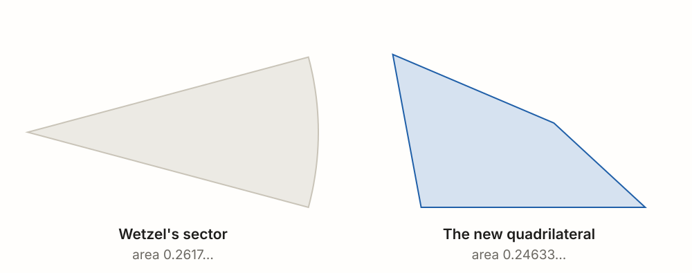
  <figcaption>The previous best upper bound (left) and the new one (right).</figcaption>
</figure>

The agents proved by contradiction that this quadrilateral is a cover. If some worm
doesn't fit, then a polygon through finitely many of its points doesn't fit either.
Every way that the polygon sticks out gives an inequality. Combining these
inequalities forces the worm itself to be longer than 1, which is impossible.
Part of the proof is computational again, since the cases are too many to handle by
hand. See the [paper](https://arxiv.org/abs/2609.21968) for more details.

<figure class="narrow">
  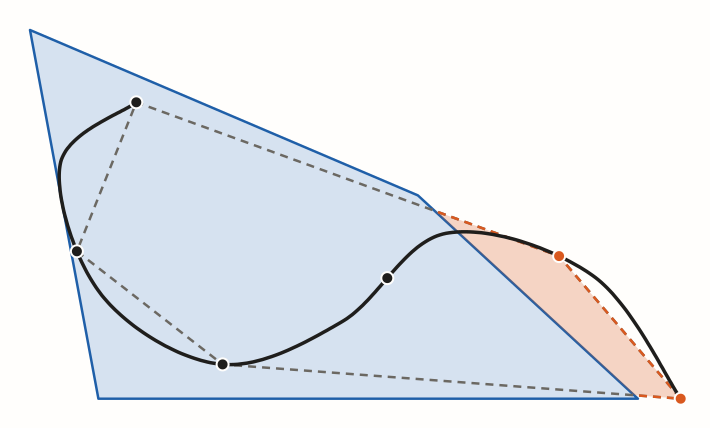
  <figcaption>A curve that doesn't fit and a polygon through six of its points.</figcaption>
</figure>

The first version of the proof was quite hard for me to follow, so I used a fresh Codex
session as a tutor. It helped me understand some of the parts where I lacked background.
Eventually, the tutor even found a shortcut that made a large part of the proof unnecessary:

> Yes—**the proposed replacement substantially shortens the full upper-bound
> argument**, to five pages with three lemmas.
{: .agent data-who="GPT-6 Astra"}

## Correctness

Despite AI referees calling the results valid, I was quite skeptical.
The models could be wrong while making their proofs look plausible.

I spent some late nights digging into the proofs myself, which improved my understanding but still didn't guarantee correctness.

So I reached out to a human expert. Prof. Hendrik Van Maldeghem, a geometer at Ghent
University, kindly took a look at an early version of the lower-bound proof. At first
sight, the arguments looked correct to him. He also suggested a way to strengthen one
of the lemmas and recommended a detailed review by a referee.

To ensure the proofs had no logical gaps, I also prompted the agents to formalize the proofs in
[Lean](https://lean-lang.org/), a proof assistant that checks every step of a formal proof down to the axioms.
It has a large community behind it, which built [mathlib](https://github.com/leanprover-community/mathlib4),
a shared library of formalized math that new proofs can build on.

Both proofs depend on computer searches, which can have bugs.
However, the searches themselves don't need to be trusted.
Each search outputs a *certificate*, a record of every case it checked,
and Lean verifies that it implies the new bounds. An invalid or incomplete certificate would simply be rejected.

<figure>
  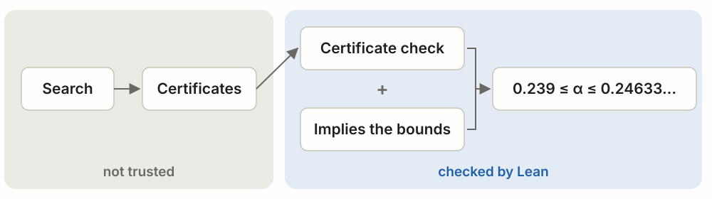
  <figcaption>An untrusted search produces certificates. Lean checks them and proves they imply the bounds.</figcaption>
</figure>

In total, Lean checked 526,164 cases for the lower bound and 12,663 for the upper bound.
It then verified that these cases imply the new bounds.
The [repo](https://github.com/ethan-keller/moser-worm-improved-bounds) contains the full formalization and scripts to run the search and verification.

## The remaining gap

In one month, off-the-shelf AI agents improved both the lower and upper bounds of Moser's worm problem, shrinking the gap between them by over 75%.
The area of the optimal convex cover now lies between $0.239$ and $0.24633\ldots$.
Where exactly the true answer lies remains open.

<figure>
  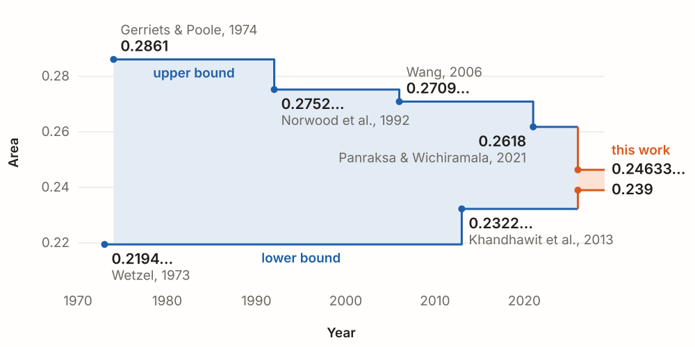
  <figcaption>The best bounds since 1970 with the new ones in orange.</figcaption>
</figure>

I did find a potential hint. The best candidate cover the agents came up with had an area of $0.24362\ldots$,
though they couldn't prove it covers every worm. It was found from searches over families of up to
302 worms.

<figure class="narrow">
  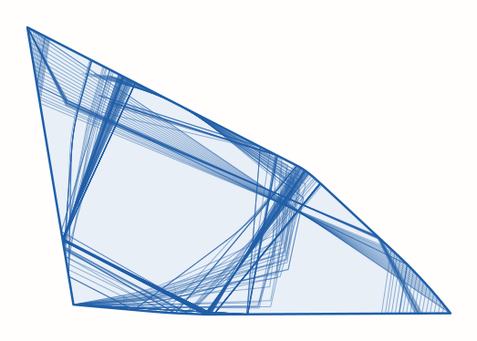
  <figcaption>The best cover candidate found, with an area of $0.24362\ldots$.</figcaption>
</figure>

This candidate could just be a local optimum, but I find it intriguing that parts of its boundary start to round,
which might be a clue about the true answer.

I later found out that two other preprints improved the bounds around the same time.
Mazur pushed the lower bound to $0.23743\ldots$,[^mazur] and Deng found a triangular cover of area
$0.25788\ldots$.[^deng] Like this work, neither has been peer reviewed yet.
Compared to these works, the new bounds still shrink the remaining gap by about 64%.

## Thoughts

I estimate I spent on average 30 minutes a day on this project.
The rest was done by about 700 agents, running day and night (apart from occasional API failures)
generating 24 million output tokens.

The result is a real step forward, but I don't think it required a fundamentally new
idea. The proof structures already existed in the literature. What AI
contributed was a better worm family, clever pruning tricks and a smaller quadrilateral.
My guess is that this was low-hanging fruit for AI.
Agents can now tackle problems that humans may not want to spend months on.

I would like to do this again, maybe on a more applied problem. But I'd likely do a few
things differently. When agents run for hours, it's almost irresistible to follow
every step and keep steering.
Next time, I'd put my effort into setting up a robust research environment with better information management,
and interrupt as little as possible. Perhaps with automatic encouragement prompts if needed.

It feels strange to trust a result that I don't fully understand.
In a sense, I have taken on some [intellectual debt](https://medium.com/berkman-klein-center/from-technical-debt-to-intellectual-debt-in-ai-e05ac56a502c).

Still, I'm optimistic about the future of scientific discovery.
Anyone with some patience can now contribute, and domain experts can move faster than ever before.
If there's a problem you care about, I'd encourage you to try it too.

## Acknowledgments

I'm grateful to Prof. Johan Deprez for connecting me with Prof. Hendrik Van
Maldeghem, who kindly looked over an early version of the lower-bound proof. And
since this all started with a high-school competition, thank you to my old teammates
and especially to Thomas Maas, an amazing math teacher whose classes I remember fondly.

## References
[^moser]: Leo Moser, *Poorly formulated unsolved problems of combinatorial geometry*, mimeographed notes, 1966.
[^kps]: Tirasan Khandhawit, Dimitrios Pagonakis and Sira Sriswasdi, *Lower bound for convex hull area and universal cover problems*, International Journal of Computational Geometry & Applications 23(3):197-212, 2013. [arXiv:1101.5638](https://arxiv.org/abs/1101.5638).
[^ks]: Tirasan Khandhawit and Sira Sriswasdi, *An improved lower bound for Moser's worm problem*, 2007. [arXiv:math/0701391](https://arxiv.org/abs/math/0701391).
[^pw]: Chatchawan Panraksa and Wacharin Wichiramala, *Wetzel's sector covers unit arcs*, Periodica Mathematica Hungarica 82(2):213-222, 2021. [arXiv:1907.07351](https://arxiv.org/abs/1907.07351).
[^bnb]: Ailsa H. Land and Alison G. Doig, *An automatic method of solving discrete programming problems*, Econometrica 28(3):497-520, 1960. [doi:10.2307/1910129](https://doi.org/10.2307/1910129).
[^mazur]: Lech Mazur, *A mixed-area lower bound for Moser's convex worm problem*, ProofAtlas, 2026. [proofatlas.ai](https://www.proofatlas.ai/formalizations/moser-worm-mixed-area-lower-bound/).
[^deng]: Zhipeng Deng, *Balanced support calibrations for Moser's worm problem: exact certificate and bound of triangular cover*, 2026. [arXiv:2609.04591](https://arxiv.org/abs/2609.04591).
